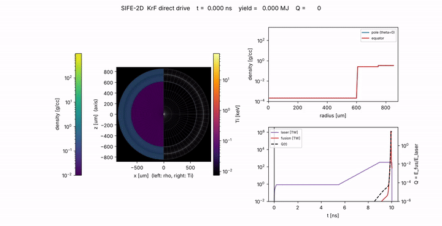

# SIFE：KrF 激光直接驱动惯性约束聚变模拟程序

SIFE (Simulation of Inertial Fusion Energy) 是一维球对称和二维轴对称拉格朗日三温辐射流体程序，覆盖 KrF (248 nm) 直接驱动 ICF 的完整物理链：

激光吸收（射线追踪 + 逆轫致）→ 电子热传导 → 烧蚀与内爆（流体）→ 冲击压缩（EOS）→ 滞止热斑 → DT 聚变 → α 粒子沉积与自加热 → 点火、燃烧与能量释放

- `docs/research_notes.md`：物理调研、模型选择、主流程序对照、参考文献
- `docs/architecture.md`：程序结构与数值方法
- `docs/results.md`：基准验证与 KrF 点火算例结果
- `benchmarks/`：8 个一维和 4 个二维验证基准（`python benchmarks/run_all.py`）
- `examples/krf_target.py`：KrF 点火靶基准设计；`examples/scan.py`：并行设计扫描；`examples/plot_krf.py`：作图
- `examples/krf_target_2d.py`：二维版本（照射不均匀、界面扰动）；`examples/plot_krf2d.py`：二维对比图
- `sife/animate.py`：动画；`sife/qvalue.py`：Q 值（靶增益、ηG、工程 Q）

## 快速开始

```bash
pip install numpy scipy numba matplotlib
python examples/krf_target.py --out output/krf        # 约 5 分钟 (单核)
python examples/plot_krf.py output/krf
python -m sife.animate output/krf                     # 动画 -> implosion.mp4 / .gif
python examples/krf_target_2d.py --out output/krf2d --illum 2:0.03   # 二维，约 1 小时 (单核)
python -m sife.animate output/krf2d
```

Q 值写在每个算例的 `summary.json` 的 `Q` 字段里，运行结束时也会打印。并行跑多个算例时请设 `NUMBA_NUM_THREADS=1`。

注意：核心算子使用 numba `cache=True`。修改 `sife/*.py` 后，请删除 `sife/__pycache__/*.nbi *.nbc`，否则跨模块内联的旧代码可能仍被使用。

## 图与动画

`docs/figures/` 收录了基准测试图、一维点火算例图（`overview.png`、`profiles.png`、`stagnation.png`）、二维对比图（`krf2d_compare.png`）和动画（`implosion1d.gif`、`implosion2d_illumP2.gif`）。完整输出（`output/`）体积大，不放进仓库，可按上面的命令重新生成。


